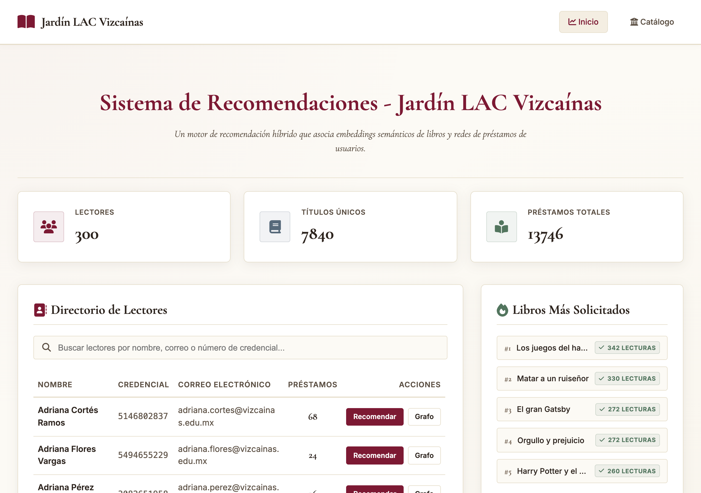
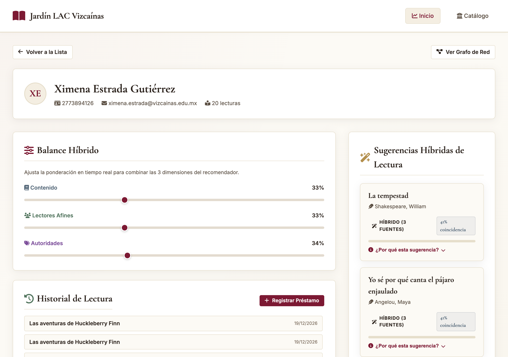
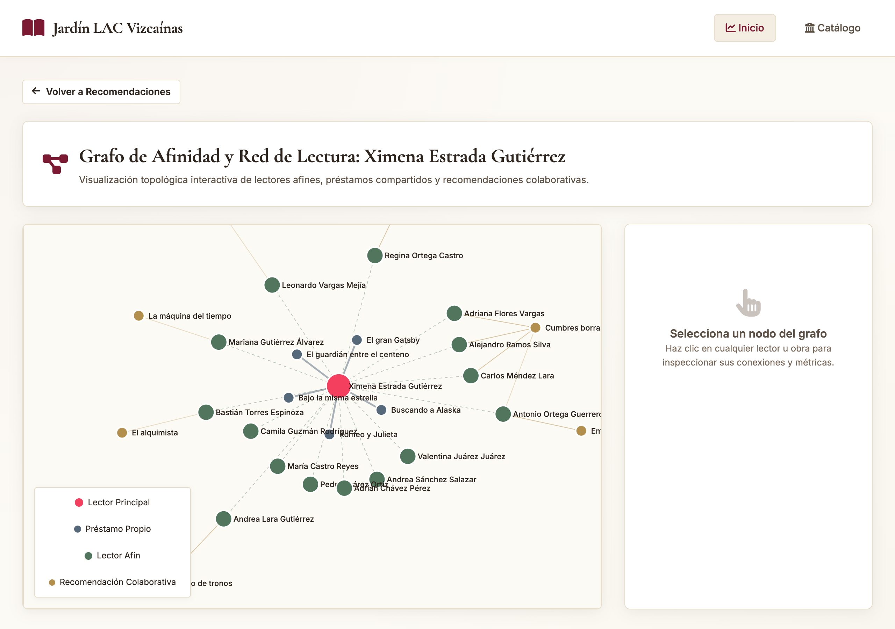
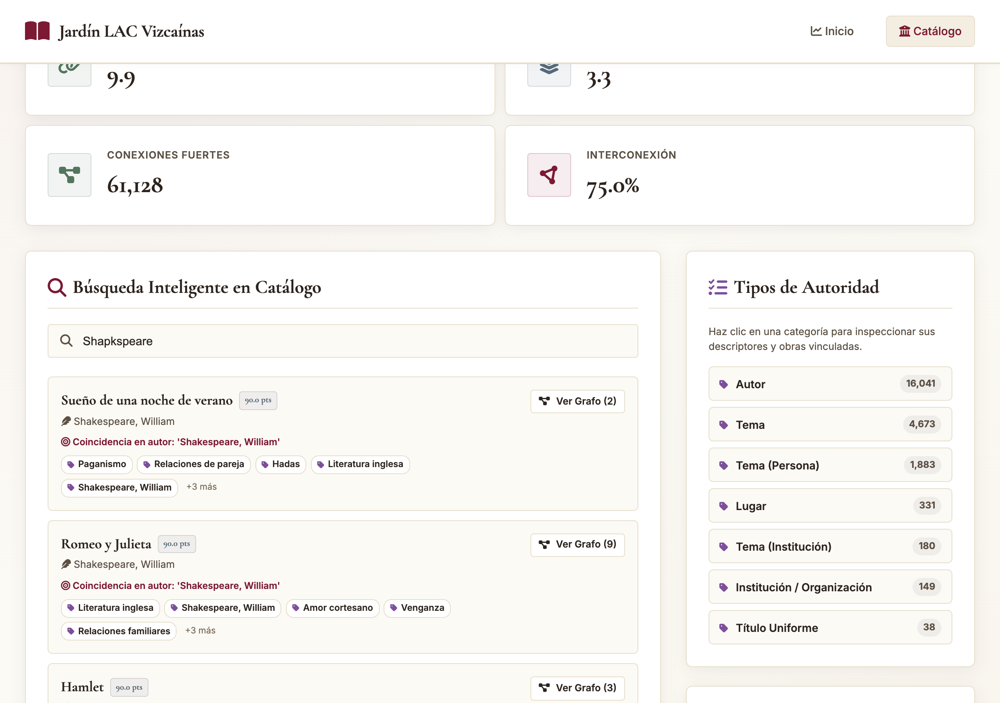
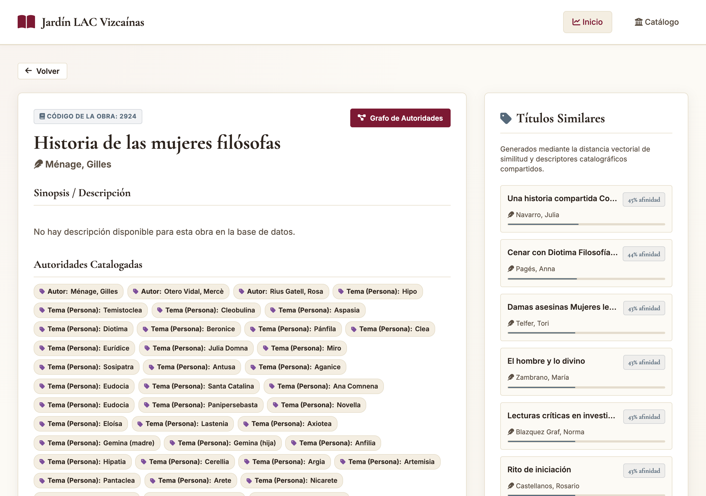
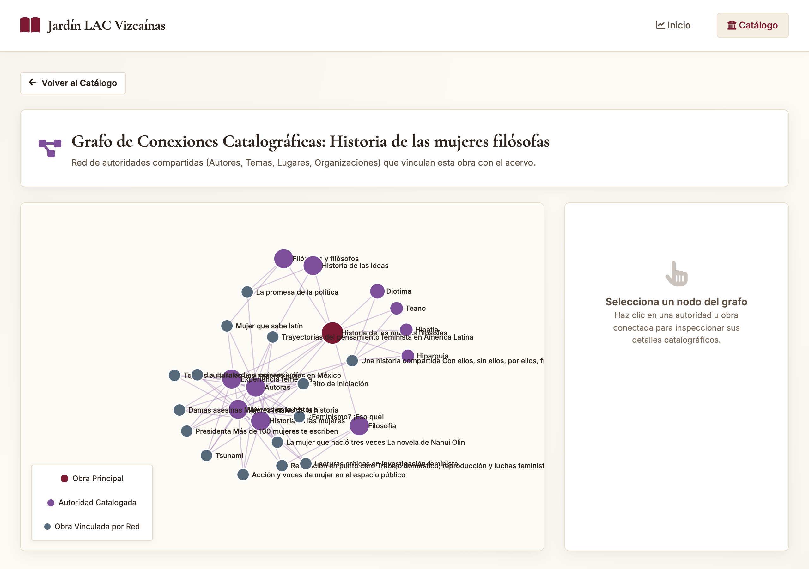

# Jardín LAC Vizcaínas: Sistema de recomendaciones y catálogo inteligente

Sistema de recomendaciones de lectura híbridas y exploración bibliográfica en red para la biblioteca **Jardín LAC**. Combina un pipeline de datos en Python (registros MARC21 de Koha ILS, similitud semántica con `sentence-transformers`, filtrado colaborativo por índice de Jaccard y grafo de autoridades ponderado por Adamic-Adar) con una aplicación web de solo lectura en **Ruby on Rails 8** (Hotwire Turbo Frames, Stimulus JS, búsqueda híbrida con SQLite FTS5 más ONNX Runtime y visualizaciones D3.js).

---

## Capturas de pantalla de la aplicación

| Panel de inicio y directorio de lectores | Perfil del lector y recomendaciones híbridas |
| :---: | :---: |
|  |  |
| *Búsqueda en tiempo real y directorio de lectores con estadísticas de préstamos.* | *Deslizadores interactivos de ponderación para contenido, lectores afines y autoridades.* |

| Grafo interactivo de afinidad entre lectores | Búsqueda inteligente en catálogo |
| :---: | :---: |
|  |  |
| *Grafo de fuerza dirigida en D3.js que conecta lectores y obras afines.* | *Búsqueda tolerante a errores tipográficos y expansión semántica.* |

| Detalle de obra e inspector de similitud | Red de autoridades catalográficas |
| :---: | :---: |
|  |  |
| *Motor de similitud en 2 niveles por embeddings semánticos y autoridades compartidas.* | *Red de autoridades (autores, materias, lugares y títulos uniformes) y obras vinculadas.* |

---

## Tabla de contenidos

- [Contexto y objetivos](#contexto-y-objetivos)
- [Arquitectura general del sistema](#arquitectura-general-del-sistema)
- [Pipeline de análisis de datos (Python)](#pipeline-de-análisis-de-datos-python)
- [Aplicación web (Ruby on Rails 8)](#aplicación-web-ruby-on-rails-8)
- [Diseño, accesibilidad (a11y) y UX](#diseño-accesibilidad-a11y-y-ux)
- [Ingesta de datos e idempotencia (Rake tasks)](#ingesta-de-datos-e-idempotencia-rake-tasks)
- [Búsqueda semántica y difusa en tiempo real](#búsqueda-semántica-y-difusa-en-tiempo-real)
- [Guía de instalación y desarrollo local](#guía-de-instalación-y-desarrollo-local)
- [Pruebas, calidad de código y seguridad](#pruebas-calidad-de-código-y-seguridad)
- [Despliegue en Render e integración continua (CI/CD)](#despliegue-en-render-e-integración-continua-cicd)

---

## Contexto y objetivos

Para facilitar el descubrimiento del acervo bibliográfico, el sistema cubre dos necesidades:

1. **Recomendaciones personalizadas de lectura**: Un algoritmo híbrido combina la similitud temática entre libros, la afinidad entre historiales de préstamo de los lectores y los descriptores de autoridad catalográfica (autores, materias, lugares y títulos uniformes).
2. **Visualización exploratoria de redes**: Lectores y bibliotecarios navegan las conexiones entre obras, usuarios y autoridades mediante grafos interactivos en D3.js.

---

## Arquitectura general del sistema

El proyecto separa la generación offline de datos en Python de la aplicación web en Rails 8, acopladas mediante archivos JSON, CSV y binarios en `data/`:

```
+-------------------------------------------------------------------------+
|                    CAPA DE ANALISIS DE DATOS (PYTHON)                   |
|                                                                         |
|  fetch_koha_catalog -> clean_catalog -> match_koha_goodreads            |
|        |                                      |                         |
|        v                                      v                         |
|  build_authority_graph    select_koha_users -> generate_names           |
|        |                        |                                       |
|        v                        v                                       |
|  embed_books (multilingue + ONNX) & build_graph (Jaccard)               |
+------------------------------------+------------------------------------+
                                     | Artefactos en data/
                                     v
+-------------------------------------------------------------------------+
|                 APLICACION WEB DE SOLO LECTURA (RAILS 8)                |
|                                                                         |
|  rails import:all -> SQLite (FTS5 + embeddings BLOB) -> Servicios       |
|                                                           |             |
|  D3.js SVG Graphs <- Hotwire (Turbo Frames / Stimulus) <--+             |
+-------------------------------------------------------------------------+
```

---

## Pipeline de análisis de datos (Python)

El directorio `pipeline/` contiene los scripts que generan los datasets consumidos por Rails. El archivo `pipeline/config.py` centraliza rutas, revisiones de modelos y normalización de texto, y `pipeline/run_pipeline.sh` orquesta los 7 pasos completos (admite `--skip-fetch` para omitir la descarga desde Koha).

```bash
bash pipeline/run_pipeline.sh
bash pipeline/run_pipeline.sh --skip-fetch
```

### 1. Extracción del catálogo Koha ILS (`pipeline/fetch_koha_catalog.py`)

- Descarga los registros MARC-in-JSON desde la API REST de Koha ILS en `data/koha/catalog.json`.
- Prioriza el subcampo `999$c` para el `biblio_id` y extrae autoridades de los campos MARC `100`, `110`, `130`, `600`, `610`, `630`, `650`, `651`, `655`, `700` y `710`.

### 2. Limpieza y normalización del catálogo (`pipeline/clean_catalog.py`)

- Limpia `data/koha/catalog.json` en sitio de forma idempotente hasta dejar **7,839 obras válidas**.
- Resuelve la colisión conocida de `biblio_id` (`8000` frente a `6993`), descarta registros de prueba (`6712` y `7982`), restaura iniciales truncadas, canoniza IDs de autoridades duplicadas o con variantes de acento, elimina enlaces duplicados por libro y rellena autores faltantes desde las autoridades `100/700/110/710`.

### 3. Cruce con datos de Goodreads (`pipeline/match_koha_goodreads.py`)

- Empareja cada obra de Koha con un único `work_id` de Goodreads tras validar apellidos del autor y descartar homónimos cortos ambiguos.
- Limpia etiquetas HTML/SGML y ruido editorial para conservar sinopsis en español en `data/koha_goodreads_mapping.json`.

### 4. Muestreo de lectores y préstamos (`pipeline/select_koha_users.py`)

- Selecciona 300 lectores representativos y deduplica préstamos por `biblio_id` para producir **7,190 filas únicas** en `data/koha_checkouts.csv`, con fechas acotadas entre `2024-01-01` y `2026-06-30`.

### 5. Perfiles sintéticos de lectores (`pipeline/generate_names.py`)

- Genera de forma determinista **300 perfiles sintéticos** en `data/patron_names.json` con nombre en español, correo `@vizcainas.edu.mx` único y credencial única de 10 dígitos.

### 6. Arquitectura semántica de dos niveles (`pipeline/embed_books.py`)

El catálogo está mayoritariamente en español, pero la aplicación corre en el plan gratuito de Render (512 MB de RAM) y se almacena en GitHub (límite de 100 MB por archivo). Por esa restricción, el pipeline separa la similitud offline de la búsqueda en tiempo real:

1. **Similitud temática offline (`paraphrase-multilingual-MiniLM-L12-v2`)**: Se ejecuta solo en Python offline sobre título, autor, hasta 12 materias específicas y sinopsis truncada para producir los 50 vecinos coseno más cercanos (`MIN_SIMILARITY = 0.30`). Genera **391,950 pares** para las 7,839 obras en `data/content_similarities.json`, lo que alimenta las recomendaciones en español sin cargar este modelo en Render.
2. **Vectores de búsqueda en tiempo real (`all-MiniLM-L6-v2` ONNX int8)**: Codifica los mismos 7,839 libros directamente con el modelo cuantizado int8 en `data/mini_lm_onnx/model_quantized.onnx` y `data/mini_lm_onnx/tokenizer.json` (~22.7 MB en total). Produce `data/embeddings.bin` (~11.5 MB, 384 dimensiones float32 normalizadas con L2) y `data/embeddings_index.json`, además de `data/book_metadata.json`. Así los libros y `QueryEmbedder` en Ruby comparten el mismo espacio vectorial cuantizado sin deriva entre entrenamiento e inferencia.

### 7. Grafos de afinidad y autoridades (`pipeline/build_graph.py` y `pipeline/build_authority_graph.py`)

- **`pipeline/build_graph.py`**: Calcula la similitud de Jaccard entre conjuntos de lectura ($J(U_1, U_2) = |U_1 \cap U_2| / |U_1 \cup U_2|$) y guarda hasta 30 vecinos por usuario (**8,986 pares** de los 300 lectores) en `data/user_graph.json`.
- **`pipeline/build_authority_graph.py`**: Calcula conexiones entre obras con ponderación Adamic-Adar / IDF ($\sum 1 / \log_2(1 + \text{df})$), suprime autoridades demasiado genéricas (`df > 400`) y exige al menos 2 autoridades compartidas o 1 autoridad específica (`df <= 20`). Guarda **23,248 autoridades** y **119,353 conexiones ponderadas** en `data/koha/authority_graph.json`.

---

## Aplicación web (Ruby on Rails 8)

### Stack tecnológico

- **Framework**: Ruby on Rails `8.1.4.1` (Ruby `3.4.13`).
- **Base de datos**: SQLite 3 (`storage/production.sqlite3` en producción, con índice virtual FTS5 `book_words_fts`).
- **Frontend**: Hotwire (Turbo Frames y Stimulus JS).
- **Visualización de grafos**: D3.js v7 (simulación de fuerzas sobre SVG).
- **Estilos**: CSS vanilla con variables personalizadas de paleta académica.
- **Inferencia semántica**: Gemas `onnxruntime` (`~> 0.11.7`) y `tokenizers` (`~> 0.7.0`).

### Modelo de datos y esquema de base de datos

```
  +-----------+         +-----------+         +----------------------+
  |  Patron   |1       *| Checkout  |*       1|         Book         |
  | (Lector)  +---------+ (Prestamo)+---------+  (Obra + embedding)  |
  +-----+-----+         +-----------+         +---+------+-------+---+
        |1                                        |1     |1      |1
        v*                                        v*     v*      v*
+------------------+                   +----------------+ | +------------+
| UserSimilarity   |                   |ContentSimilarity | | BookWord   |
|(Jaccard lectores)|                   |(Coseno offline)| | |(Vocabulario|
+------------------+                   +----------------+ | +-----+------+
                                                          |       | FTS5
  +-----------+1       *+---------------+*                |       v
  | Authority +---------+ BookAuthority +-----------------+  book_words_fts
  | (MARC21)  |         |(Union libro)  |                 |
  +-----------+         +---------------+                 |*
                                                  +-------+--------+
                                                  | BookConnection |
                                                  | (Adamic-Adar)  |
                                                  +----------------+
```

1. **`Book`**: Registro bibliográfico (`title`, `author`, `normalized_title`, `normalized_author`, `description`, `source`, `embedding` BLOB, `embedding_model`).
2. **`Patron`**: Lector sintético (`name`, `normalized_name`, `email`, `cardnumber`, `checkouts_count`).
3. **`Checkout`**: Historial de préstamos (`checkout_date`, indicador `simulated` en esquema; la interfaz web es de solo lectura).
4. **`Authority`**: Entidad de autoridad MARC21 (`name`, `authority_type`, `marc_field`, `books_count`).
5. **`BookAuthority`**: Relación única entre obra y autoridad.
6. **`BookConnection`**: Arista ponderada entre `source_book_id` y `target_book_id` derivada del grafo de autoridades.
7. **`ContentSimilarity`**: Similitud temática precalculada entre dos libros (`0.0` a `1.0`).
8. **`UserSimilarity`**: Similitud de Jaccard precalculada entre dos lectores (`0.0` a `1.0`).
9. **`BookWord` y `book_words_fts`**: Índice por palabra de títulos, autores y autoridades (`book_words`) sincronizado con la tabla virtual SQLite FTS5 (`book_words_fts`, tokenizer `trigram`).

### Motor de recomendación híbrido (`RecommendationService`)

Calcula recomendaciones en tiempo real combinando tres señales normalizadas por su máximo:

$$S_{\text{final}}(B) = w_{\text{content}} \cdot \hat{S}_{\text{content}}(B) + w_{\text{collab}} \cdot \hat{S}_{\text{collab}}(B) + w_{\text{auth}} \cdot \hat{S}_{\text{auth}}(B)$$

- Los pesos $w_{\text{content}}, w_{\text{collab}}, w_{\text{auth}}$ se ajustan con deslizadores en `/users/:id`. En el servidor se acotan al rango `0..1`, se normalizan para sumar `1` y vuelven a valores por defecto si llegan parámetros inválidos.
- Las explicaciones nombran la lectura previa más cercana por contenido o las autoridades compartidas concretas con el historial del lector.
- La lista aplica una reordenación por diversidad para reducir la repetición de autores en los primeros lugares.

### Motor de similitud en 2 niveles para obras (`BooksController` y `SimilarBooksQuery`)

Al consultar `/books/:id`, `SimilarBooksQuery` ejecuta dos niveles:

1. **Nivel primario**: Obtiene los vecinos más cercanos desde `ContentSimilarity`.
2. **Nivel secundario**: Si la obra carece de vecinos precalculados, agrupa libros por el número de autoridades compartidas mediante `BookAuthority`.

### Visualizaciones interactivas D3.js

1. **Grafo de afinidad de lectores (`/users/:id/graph`, datos en `/api/graph/:id`)**: Muestra al lector seleccionado conectado con sus lectores afines y las obras asociadas, con panel lateral inspector.
2. **Grafo de autoridades catalográficas (`/catalog/graph/:id`, datos en `/api/catalog/graph/:id`)**: Muestra una obra rodeada de sus autoridades MARC21 y libros relacionados, con filtros por tipo de nodo.

---

## Diseño, accesibilidad (a11y) y UX

- **Tipografía**: *Cormorant Garamond* para encabezados e *Inter* para cuerpo y datos.
- **Paleta de color**: Fondo pergamino (`#fcfaf5`), borgoña institucional (`#7c1933`) y dorado académico (`#b38f4d`).
- **Navegación por teclado**: Indicadores `:focus-visible` de alto contraste, etiquetas `.sr-only` y atributos `aria-label` en buscadores y controles deslizantes.
- **Uso móvil**: Áreas táctiles mínimas de `44px` y tamaño de fuente de `16px` en campos de entrada para evitar zoom automático en iOS Safari.
- **Búsqueda y estados**: Conteo de resultados, botón de limpieza y estados vacíos con sugerencias.

---

## Ingesta de datos e idempotencia (Rake tasks)

La carga completa es idempotente y se invoca con:

```bash
bin/rails import:all
```

Ejecuta estos 9 pasos en orden:

1. `import:patrons`: Carga 300 lectores desde `data/patron_names.json`.
2. `import:books`: Carga 7,839 libros desde `data/koha/catalog.json` y enriquece sinopsis desde `data/book_metadata.json`.
3. `import:checkouts`: Carga 7,190 préstamos históricos desde `data/koha_checkouts.csv` y actualiza `patrons.checkouts_count`.
4. `import:authorities`: Carga 23,248 autoridades y 77,806 enlaces `BookAuthority` desde `data/koha/catalog.json`, eliminando autoridades sin libros.
5. `import:book_connections`: Carga 119,353 conexiones ponderadas en `book_connections` desde `data/koha/authority_graph.json`.
6. `import:content_similarities`: Carga 391,950 pares en `content_similarities` desde `data/content_similarities.json`.
7. `import:user_similarities`: Carga 8,986 pares en `user_similarities` desde `data/user_graph.json`.
8. `import:embeddings`: Carga los 7,839 vectores de 384 dimensiones desde `data/embeddings.bin` y `data/embeddings_index.json` en `books.embedding`.
9. `import:book_words`: Pobla `book_words` con tokens normalizados de títulos, autores y autoridades, y reconstruye la tabla virtual FTS5 `book_words_fts`.

---

## Búsqueda semántica y difusa en tiempo real

`CatalogSearchService` combina coincidencia léxica resiliente con similitud semántica en tiempo de consulta:

1. **Coincidencia exacta y por prefijo (`LIKE`)** sobre título y autor, priorizada para evitar que coincidencias ruidosas desplacen aciertos directos.
2. **Índice FTS5 trigram (`book_words_fts`)** administrado por `FuzzyBookLookup` para tolerar inserciones, omisiones y prefijos parciales con ~1 a 5 MB de caché de página en disco.
3. **Fallback acotado de transposición** sobre `book_words` usando distancia Damerau-Levenshtein (por ejemplo, `rulsfo` hacia Rulfo).
4. **Puntuación semántica en runtime (`QueryEmbedder`)**: Cuando `data/mini_lm_onnx/model_quantized.onnx` y `books.embedding` están disponibles, `QueryEmbedder` codifica la consulta con `onnxruntime` y `tokenizers` y la combina con la puntuación léxica:

```
final_score = (1 - w_semantic) * token_score + w_semantic * semantic_score
```

El peso por defecto es `w_semantic = 0.35`. Si el modelo ONNX no está presente, la búsqueda degrada de forma segura a coincidencia por tokens. En entorno de desarrollo o pruebas admite `debug: true` para inspeccionar fuentes candidatas y componentes de puntuación.

```
  pipeline/embed_books.py                  ONNX Runtime (C++)
       |                                          ^
       | genera                                   | infiere
       v                                          |
  data/embeddings.bin  ---> import:embeddings ---> books.embedding (BLOB)
  data/embeddings_index.json                            |
                                                        v
  data/mini_lm_onnx/  ----------------------------> QueryEmbedder
       ^                                                ^
       |                                                |
  pipeline/export_onnx.py                     CatalogController#search
  (one-time, offline)
```

### Regenerar el modelo ONNX

Si cambias la revisión de `sentence-transformers/all-MiniLM-L6-v2`, ejecuta offline:

```bash
pip install -r requirements-export.txt
SENTENCE_TRANSFORMER_REVISION=<nuevo-sha> python3 pipeline/export_onnx.py
python3 pipeline/embed_books.py --skip-similarities
bin/rails import:embeddings
```

---

## Guía de instalación y desarrollo local

### Requisitos previos

- **Ruby**: `3.4.13` (ver `.ruby-version`)
- **Rails**: `8.1.4.1`
- **SQLite3**: `>= 3.35.0` con soporte FTS5
- **Python 3.12+** (opcional, solo para ejecutar el pipeline en `pipeline/` o sus pruebas)

### Pasos de instalación

1. Clonar el repositorio:

   ```bash
   git clone git@github.com:lander16/jardin-lac-vizcainas-recs.git
   cd jardin-lac-vizcainas-recs
   ```

2. Instalar gemas de Ruby:

   ```bash
   bundle install
   ```

3. Preparar el esquema de base de datos sin doble importación e ingestar los datos:

   ```bash
   SKIP_SEEDS=1 bin/rails db:prepare
   bin/rails import:all
   ```

4. Iniciar el servidor de desarrollo:

   ```bash
   bin/rails server
   ```

   Abre `http://localhost:3000` en el navegador.

---

## Pruebas, calidad de código y seguridad

Suite de pruebas de Rails:

```bash
bundle exec rails test
```

Pruebas del pipeline en Python (solo usa biblioteca estándar):

```bash
python3 -m py_compile pipeline/*.py pipeline/tests/*.py
python3 -m unittest discover -s pipeline/tests -v
```

Estilo de código Ruby con RuboCop:

```bash
bin/rubocop
```

Análisis estático de seguridad con Brakeman:

```bash
bin/brakeman --no-pager
```

Auditoría de gemas y dependencias JavaScript:

```bash
bin/bundler-audit check --update
bin/importmap audit
```

---

## Despliegue en Render e integración continua (CI/CD)

### GitHub Actions (CI)

El flujo `.github/workflows/ci.yml` se ejecuta en `pull_request` y en `push` a `main`, con permisos `contents: read` y cancelación automática de corridas previas por rama:

- `scan_ruby`: Ejecuta `bin/brakeman --no-pager` y `bin/bundler-audit check --update`.
- `scan_js`: Ejecuta `bin/importmap audit`.
- `lint`: Ejecuta `bin/rubocop -f github`.
- `python`: Compila los scripts con `py_compile` y ejecuta `pipeline/tests` en Python 3.12.
- `test`: Prepara la base de pruebas y ejecuta `bin/rails db:test:prepare test`.
- `import_smoke`: Ejecuta `SKIP_SEEDS=1 bin/rails db:prepare && bin/rails import:all`, verifica conteos mínimos en todas las tablas (`books`, `patrons`, `checkouts`, `authorities`, `book_connections`, `content_similarities`, `user_similarities`, `book_words`, `book_words_fts` y `embeddings`) y corre las pruebas de búsqueda en vivo con `RUN_IMPORT_SMOKE=1 bin/rails test test/integration/smoke_search_test.rb`.

### Despliegue en Render (Plan Gratuito)

`render.yaml` y `bin/render-build.sh` están configurados para los límites del plan gratuito de Render (512 MB de RAM y 0.1 CPU):

- **Base SQLite efímera en tiempo de build**: Render Free Tier no admite discos persistentes, y montar un disco sobre `/opt/render/project/src/storage` ocultaría la base generada durante el build. Como la aplicación es 100% de solo lectura, `storage/production.sqlite3` se construye una vez en el build de despliegue.
- **Script de build (`bin/render-build.sh`)**: Usa `set -euo pipefail`, excluye grupos de desarrollo y pruebas con `bundle config set --local without 'development test'`, corre `bundle install`, ejecuta `SKIP_SEEDS=1 bundle exec rails db:prepare` seguido de una única llamada a `bundle exec rails import:all`, valida conteos mínimos de `books`, `book_words`, `book_words_fts` y `embeddings` sin ocultar `stderr`, y precompila los assets.
- **Puma en un solo proceso (`render.yaml`)**: Fija `WEB_CONCURRENCY="0"` y `RAILS_MAX_THREADS="1"` para evitar el fork de un proceso worker adicional, manteniendo una sola copia del runtime ONNX y de la caché SQLite en memoria.
- **Health check y endurecimiento (`config/environments/production.rb` y `config/initializers/version.rb`)**: `render.yaml` define `healthCheckPath: /healthz`. `production.rb` silencia logs de `/healthz`, habilita protección contra DNS rebinding con `RENDER_EXTERNAL_HOSTNAME` y la variable opcional `ALLOWED_HOSTS` (lista separada por comas), y excluye `/healthz` tanto de `host_authorization` como de la redirección HTTPS en `ssl_options`. `CURRENT_GIT_SHA` lee `RENDER_GIT_COMMIT` (recortado a 7 caracteres si supera 12), `GIT_REV` o `git rev-parse --short HEAD` para reportarlo en `/healthz`.
